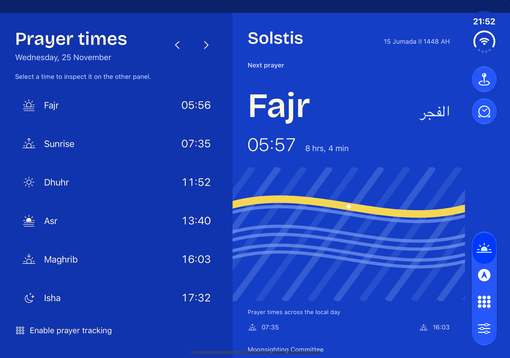
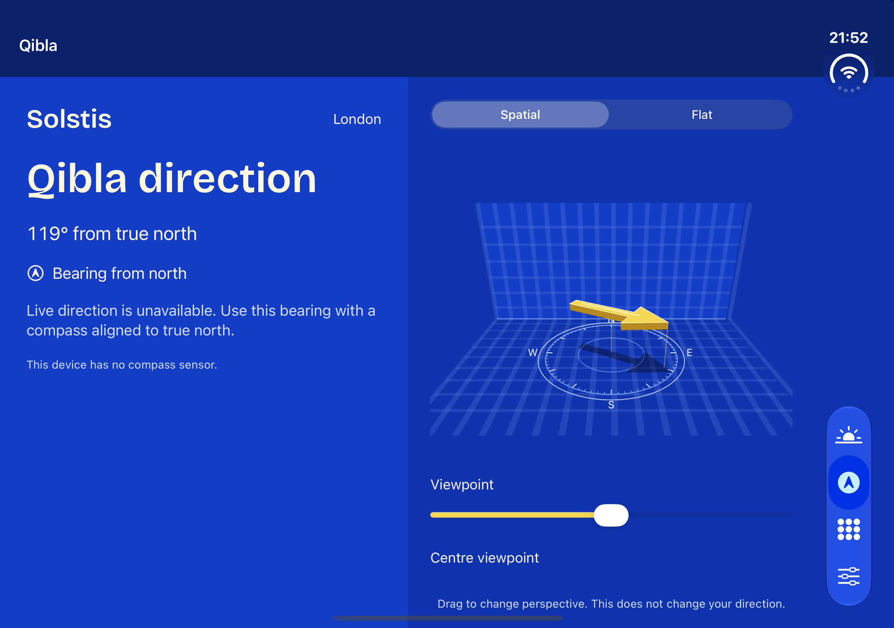
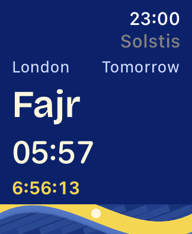
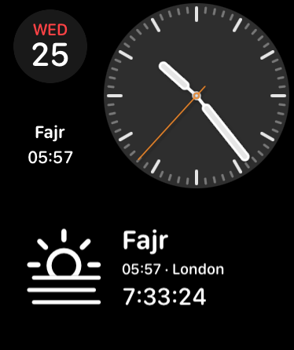
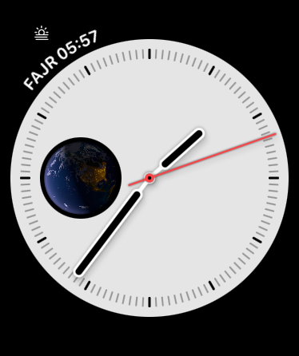

# Solstis

**A native prayer companion designed for iPhone Duo and Apple Watch.**

SwiftUI · WidgetKit · Watch Connectivity · Core Location · Swift 6

Solstis explores how a daily utility can make purposeful use of a folding phone: a timetable on one display controls the prayer shown on the other, a partial fold becomes a tabletop clock, and the cover keeps the next prayer within easy reach.

## Weave

The interface combines cobalt, cream and gold with Bricolage Grotesque. Its woven graphic is drawn from calculated prayer events and the duration of the local day, including daylight-saving changes. The design carries through to small watch screens and glanceable widgets.

## Spatial Qibla

A projected plane and raised gold arrow give the Qibla screen depth. The arrow uses calculated bearing and live heading when available. Touch changes the viewpoint; unavailable sensors produce an explicit true-north bearing fallback. A flat mode and reduced-motion presentation keep the information accessible.

## A companion for the wrist

The watch calculates locally from a cached location and prayer method synced by the phone. The phone sends a deliberately limited configuration; prayer history and audio/reminder preferences stay on the phone. Next prayer, timetable, Qibla bearing and sync status have dedicated watch screens.

| Watch app · 40mm | Actual complication host · 42mm |
| --- | --- |
|  |  |

## Engineering decisions

- **Established calculations:** twelve selectable methods through pinned Adhan Swift, with Hanafi Asr, high-latitude rules and explicit adjustments.
- **Local time:** prayer dates, tomorrow rollover and widget boundaries use the selected location’s time zone.
- **Native fold layouts:** separate open, tabletop and cover presentations rather than scaling one screen.
- **Shared presentation:** WidgetKit and watch complications reuse a common visual language while respecting each family’s space.
- **Offline operation:** calculations work without a remote calculation service; recordings are optional downloads with integrity checks.
- **Swift concurrency:** Watch Connectivity callbacks transfer the minimal payload before updating main-actor state.

## Validation and release status

**Pre-release, not yet available on the App Store.** Verification includes 18 core tests, native Duo simulator flows, watch sync/navigation on 40mm and 42mm simulators, circular, rectangular and corner complications in real watch-face hosts, small/medium/large Home Screen widget host tests, a watch main-flow accessibility audit, and a build 2 distribution export with 45 resource checks and signatures across four products.

Physical-device compass and locked-reminder testing, inline/Lock Screen host checks, iPhone accessibility audit findings, watch Always On/VoiceOver, recording permissions and final store preparation remain open. The watch displays a Qibla bearing rather than a live compass. Full adhan playback is foreground-only; notifications use short excerpts.

The intended business model is a one-time purchase. Application source is maintained privately because this is a commercial product; this repository documents the design and engineering work.

## Capture provenance

All images are actual simulator captures, not generated concept renders. Phone captures use the Duo simulator; watch captures use the 40mm SE 3 and 42mm Series 12 simulators. The complication images are Apple’s Modular Compact face hosting Solstis circular and rectangular complications, and Infograph hosting its curved corner complication. Simulator evidence does not establish physical-device behaviour.

## Credits and usage

Adhan Swift by Batoul Apps supplies prayer calculations under the MIT licence. Bricolage Grotesque is distributed under the SIL Open Font Licence. Apple’s simulator interface and watch face appear in the captures.

Screenshots, Solstis branding and project materials are presented for portfolio review. No licence to redistribute the app or its recordings is granted.
